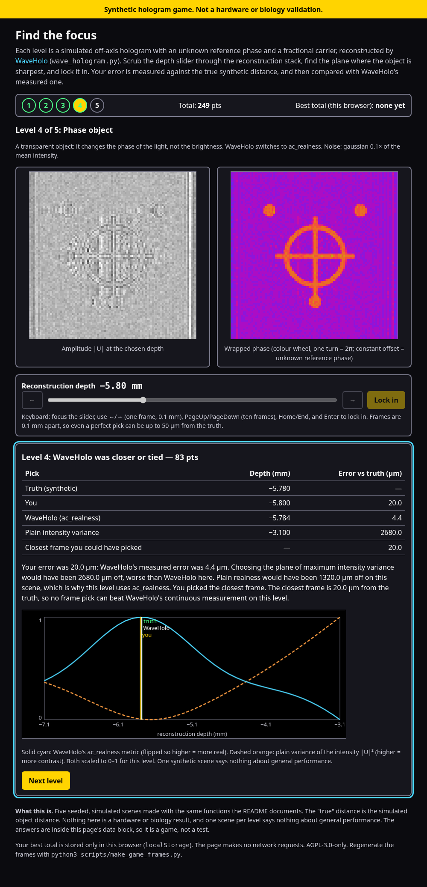

# wave-hologram

[](https://github.com/sparkainlp-x/waveholo/actions/workflows/ci.yml)

Real digital holography, end to end: record an off-axis hologram,
reconstruct the object by numerical back-propagation, and **measure**
the focus distance instead of assuming it. As of v0.1.3, this is
validated against logged stage positions on 530 real microscope
holograms.

## Install

`wave_hologram.py` is a single flat module. It is not published on PyPI. Use it
from a clone:

```
git clone https://github.com/sparkainlp-x/waveholo.git
cd waveholo
python3 -m venv .venv && . .venv/bin/activate
pip install -e .                 # numpy + matplotlib
pip install -e ".[dhm]"          # adds Pillow, for real_data/dhm_v013.py
pip install -e ".[notebook]"     # adds jupyter, to run examples/waveholo_demo.ipynb
```

The tests pass on Python 3.9 to 3.14 (checked locally and in CI for 3.9 to
3.14). Plain `python3 wave_hologram.py` also works without installing.

## Quickstart

```python
import numpy as np
import wave_hologram as W

obj = W.make_object()                                    # synthetic ring, cross, dots
sensor = W.angular_spectrum(obj.astype(complex), 5.0e-3) # 5 mm to the sensor
holo = W.record_hologram(sensor, car=80.37, ref_phase=1.2)   # unknown piston, fractional carrier

carrier = W.estimate_carrier_2d(holo, dc_radius=30.0 / W.N)  # sub-bin, from the hologram
field0 = W.reconstruct_field(holo, carrier=carrier)
res = W.find_focus(field0, np.linspace(-10e-3, 0.0, 101))    # metric="realness"
print(res["z"] * 1e3, "mm")      # -4.998 (truth -5.000)
```

This is `examples/quickstart.py` (`python3 examples/quickstart.py` also writes a
figure). `examples/waveholo_demo.ipynb` is the same walk-through as an executed
notebook with plots, plus one phase-object scene. Both are synthetic.

## Run

```
python3 wave_hologram.py                       # demo: video + still + curve
python3 wave_hologram.py --ref-phase 1.2 --carrier 80.37   # realistic: unknown
                                               # piston, fractional carrier
python3 wave_hologram.py --metric ac_realness  # phase / mixed objects
python3 wave_hologram.py --no-video
python3 studies.py                             # S1–S10 research studies (~8 min)
python3 real_data/dhm_v013.py --data <dir>     # real DHM validation
python3 -m unittest discover -s tests -v       # 56 tests (43 v0.1.3 + 13 for the game/examples)
```

Requires numpy and matplotlib. ffmpeg is needed for the MP4 and Pillow
for the DHM TIFFs.

## What v0.1.3 measures

- **Real microscope (Cuenat et al. DHM, 10×, 530 holograms, 6 stage
  positions):** focus tracks the stage with slope −96.4 ± 1.3 µm/µm,
  which is about M² = 100. Class means lie 0.19 µm (in stage units)
  from the line.
- **Synthetic demo** (fractional carrier 80.37, reference piston
  1.2 rad, both unknown to the pipeline): truth −5.000 mm, measured
  −4.998 mm (2 µm error), recovery correlation 0.956.
- **Noise** (random piston in every trial): realness is 12/12 within
  0.1 mm up to 0.35× gaussian noise and down to 100 photons per pixel.
  The v0.1.2 metric manages 0–2/12 at every level.

The full write-up, with all tables and figures, is
**[RESULTS_v0.1.3.md](RESULTS_v0.1.3.md)**. Changes are listed in
[CHANGELOG.md](CHANGELOG.md).

## Default pipeline

1. Sub-bin carrier from the hologram (`estimate_carrier_2d`, error
   ≤ 0.03 bins).
2. Sideband filter, optionally cropped losslessly (`reconstruct_field`).
3. For objective-based DHM, remove the lens curvature first
   (`remove_quadratic_phase`).
4. `find_focus`: coarse sweep, then golden-section refinement of
   **realness** = |Σ U²| / Σ |U|². This metric is invariant to the
   unknown reference phase. Use `ac_realness` for phase objects and
   `local_focus_map` for multi-plane samples.

## Find the focus (game)

[`docs/game/index.html`](docs/game/index.html) is a small offline game: five
simulated holograms, a depth slider, and a score against the true synthetic
distance and against WaveHolo's measured one. Open the file in a browser
(`file://` works), or play it on GitHub Pages:
<https://sparkainlp-x.github.io/waveholo/game/>.



- **Banner in the page:** "Synthetic hologram game. Not a hardware or biology
  validation."
- **Where the frames come from:** `scripts/make_game_frames.py` runs
  `record_hologram`, `estimate_carrier_2d`, `reconstruct_field` and
  `find_focus` on seeded objects with an unknown reference piston and a
  fractional carrier. It stores 41 frames per level (0.1 mm apart,
  24 gray levels, amplitude and wrapped phase) plus the true focus and
  WaveHolo's measured focus. `python3 scripts/make_game_frames.py` rewrites the
  data inside the page; `--check` compares it with a regeneration.
- **Offline and private:** one HTML file, no network requests, no trackers,
  best score kept only in `localStorage`.

Recorded results (this repository, seed-fixed; `error` = |measured − true|):

| Level | Scene | Noise | WaveHolo metric | WaveHolo error | Plain intensity-variance maximum |
|---|---|---|---|---:|---:|
| 1 | ring, cross, dots | Gaussian 0.05× | realness | 17.2 µm | 63.0 µm |
| 2 | random discs | Gaussian 0.2× | realness | 1.3 µm | 113.0 µm |
| 3 | random diamonds | Poisson, 100 photons | realness | 39.5 µm | 2582.0 µm |
| 4 | binary phase π/2 object | Gaussian 0.1× | ac_realness | 4.4 µm | 2680.0 µm |
| 5 | random bars | Gaussian 0.8× | realness | 315.9 µm | 150.0 µm |

On level 4, plain `realness` is 1320 µm off, so that level uses `ac_realness`
(as the "Default pipeline" below recommends for phase objects). On level 5 the
plain intensity-variance maximum is closer than WaveHolo. Neither result is
tuned.

Game limits: five fixed scenes prove nothing about general performance.
Frames are 0.1 mm apart, so a human pick can be up to 50 µm from the truth,
while WaveHolo's `find_focus` refines continuously (levels 1, 2 and 4 cannot be
beaten by any frame pick). The answers are in the page source. It is not a
hardware, microscope or biology validation.

## Honest limits

- The DHM test covers 6 of 100 stage positions (Z −50…−37 µm) and
  checks the slope, not absolute focus. Metric slopes differ (85 / 96
  / 108) because curvature removal rescales coordinates.
- The residual synthetic bias (up to ±50 µm for sharp objects, ≤ 1.6 µm
  for band-limited ones) is sideband cross-talk, set by the recording
  geometry.
- No metric wins on every object. Smooth phase objects and two
  materials on separate supports remain unsolved.
- `imag_energy` and its sub-micron "comb" (v0.1.2) are superseded: the
  comb was the λ/2 piston oscillation, aliased by 1 µm sampling. The
  metric is kept only for comparison.
- The MP4 stores rendered views, not the complex field.
- This is OPTICAL holography (wavefronts), not associative holographic
  memory and not the LED fan display.

## Data credits
- pyDHM fly-head hologram `real_data/fly-20x.bmp` (MIT),
  https://github.com/catrujilla/pyDHM.
- Cuenat et al. DHM dataset, Zenodo 6337535 (CC-BY-4.0),
  https://doi.org/10.5281/zenodo.6337535.

Details and licence texts are in
[THIRD_PARTY_NOTICES.md](THIRD_PARTY_NOTICES.md). Project direction is in
[WAVEHOLO_DIRECTION.md](WAVEHOLO_DIRECTION.md).

## Cite

Archived on Zenodo. Concept DOI (always the latest version):
[10.5281/zenodo.23644416](https://doi.org/10.5281/zenodo.23644416). DOI of
v0.1.4: [10.5281/zenodo.23644417](https://doi.org/10.5281/zenodo.23644417).
`CITATION.cff` has the same metadata.

`.zenodo.json` supplies the creator's ORCID, affiliation, and the
`AGPL-3.0-only` license for future GitHub release deposits. Keep it in the
tagged release and check the resulting Zenodo record before publishing.
It does not update the existing v0.1.4 record: its owner must sign in to
Zenodo, edit the record's metadata to add the ORCID and affiliation and
replace `apgl-v3` with `AGPL-3.0-only`, then publish the metadata changes.
No replacement archive or new software version is needed for that correction.

License: AGPL-3.0-only (see `LICENSE`).
